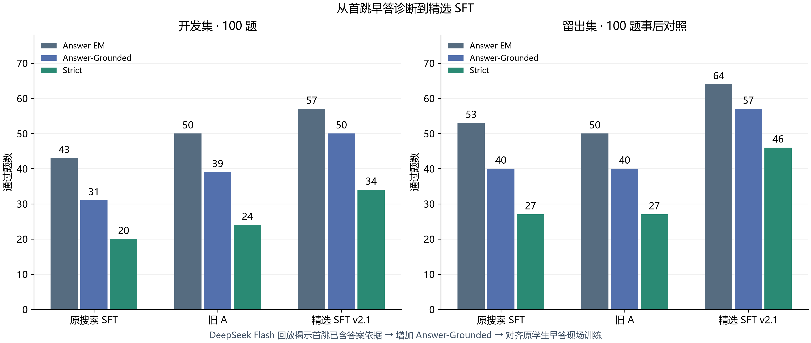

# Wiki 多跳检索 Agent

训练 Qwen3-4B 在本地 Wikipedia 语料中决定何时搜索、下一步查什么，以及何时提交答案。项目包含 SQLite BM25 检索 API、LoRA 后训练和可逐步回放查询、证据与答案的评测台。

**精选轨迹 SFT v2.1 在 100 道本地留出题上，将答对且找齐标注证据的题数从 27 道提高到 46 道。** [项目进展与课堂展示](docs/project-progress.md) · [训练配方与复现](docs/selected-sft.md) · [完整实验结果](docs/course-results.md)

## 主要结果

下表为历史冻结留出集的事后同题对照。各组使用同一 BM25 索引、提示词和搜索预算。v2.1 在开发集的 Strict 从原学生的 20/100 提高到 34/100，通过预设门槛后进入留出对照。

| 模型 | Answer EM | Answer-Grounded | Strict | 平均搜索次数 |
| --- | ---: | ---: | ---: | ---: |
| 原搜索 SFT | 53/100 | 40/100 | 27/100 | 1.03 |
| A · 定向继续 SFT | 50/100 | 40/100 | 27/100 | 1.22 |
| **精选 SFT v2.1** | **64/100** | **57/100** | **46/100** | 1.52 |

Answer EM 衡量答案匹配。Answer-Grounded 要求正常提交、答案匹配，且模型看到含答案的标注支持句或全部标注支持句。是非题要求看到全部标注支持句。Strict 要求正常提交、答案匹配且全部标注支持句可见。 [留出集汇总](runs/reopd/course-extra/selected-sft/summary.json)

相对原学生，v2.1 有 23 道 Strict 改善、4 道回退，零检索答错从 24 道降到 5 道。固定首跳后，10 道仍缺直接依据的开发题里有 3 道改用不同查询，0 道补到新支持句。直接提供标准支持句时，原学生答对 20/27，v2.1 答对 18/27。下一轮重点验证二跳查询质量和答案提取。 [固定首跳诊断](runs/reopd/selected-sft-v2.1/grounded-summary.json) · [阅读诊断](runs/reopd/selected-sft-v2.1/oracle-summary.json)



## 后训练方法

1. **从学生实际出错的位置选示范。** 训练优先覆盖 40 道零检索答错题，以及 12 道从学生真实首跳结果成功补查的题。筛选器回放搜索，检查续查是否新增标注支持句，并剔除重复查询。
2. **同时训练首查、补查和正常提交。** 每完整轮按 48、48、24 条分配动作。v2.1 处理 249 条动作、29,970 个监督 token，累计 32 次参数更新。训练和重载约 181 秒。
3. **先用开发集验证。** v2 的开发集 Strict 是 18/100。v2.1 使用同一批动作及相同重复次数，将学习率从 `2e-5` 提高到 `8e-5`，并混排不同动作。两项改动各自的贡献仍待消融。

[训练与复现记录](docs/selected-sft.md) · [v2.1 适配器](runs/reopd/selected-sft-v2.1/adapter) · [训练日志](runs/reopd/selected-sft-v2.1/metrics.json)

## 数据与评测

| 数据 | 在项目中的用途 |
| --- | --- |
| HotpotQA `distractor/train` | 从公开题目抽取 **800 道**，分为 SFT 种子 300、策略训练与轨迹采集 300、dev 100、本地留出 test 100。题目、答案和支持句来自原数据。 |
| 英文 Wikipedia 候选段落 | 将候选段落和背景材料整理为 **20,000 个共享检索块**。所有题搜索同一语料库。正式实验使用 SQLite BM25，每次最多返回 3 块，每题最多搜索 6 次。 |
| HotpotQA 官方 `distractor/dev` 和 ReOPD `baohao/search-test` 的 2WikiMultiHopQA 来源题目 | 已完成首批 HotpotQA 和 2Wiki 各 100 道题的配对评测。另备有第二批 100 道 HotpotQA 题。 |

本地留出分数对应项目划分和固定语料库。公开数据扩展评测同样使用按来源构建的共享索引。数据版本、抽样和评分方式见 [HotpotQA 数据与检索](docs/hotpot-search.md)、[公开评测实现](hotpot_search/reopd_public_eval.py)和 [ReOPD 实验记录](docs/reopd-local.md)。

## 历史 ReOPD 对照

从公开的 **Qwen3-4B 搜索 SFT** 权重初始化学生，使用公开的 **Qwen3-4B 搜索 SFT-RL** 权重作为冻结教师。ReOPD 回放已有的搜索历史，让学生生成下一步动作，由教师逐 token 提供蒸馏信号。定向组额外使用经教师续跑和人工复核的失败状态，目标是改善「未检索就答错」。四组各跑两个训练种子，每份 LoRA 更新 **12,000 个学生 token**。 [ReOPD 论文](https://arxiv.org/abs/2607.04763) · [实验设计](docs/reopd-execution-plan.md)

| 模型或训练方法 | 端到端有证答对 | 固定故障恢复 |
| --- | ---: | ---: |
| 原搜索 SFT 学生 | 27/100 | 0/24 |
| A · 定向继续 SFT | 27/100 | 2/24 |
| B · 教师前缀回放 ReOPD | 23/100 | 1/24 |
| C · 非定向混合 ReOPD | 25/100 | 1/24 |
| D · 定向恢复 ReOPD | 23/100 | 2/24 |

表中为冻结后的本地留出测试，主训练种子为 42。「有证答对」要求答案匹配且检索结果覆盖所需支持证据。D 和 A 都恢复了 2 道固定故障题，同预算下训练耗时分别约 5,317 秒和 92 秒。D 的端到端通过率比 A 低 4 个百分点，配对 95% 区间为 −12 至 +3 个百分点。这次实验没有证据表明定向 ReOPD 优于定向 SFT 或教师前缀回放。 [最终结果与复现](docs/reopd-local.md#最终结果2026-11-22)

同一批本地 100 题还用于通用基座、混合检索及早答复核的事后分析。外部 2Wiki 批次上，A 的 Strict 从原搜索 SFT 的 26/100 提升到 37/100。v2.1 的外部评测待完成。 [课程实验结果](docs/course-results.md)

## 在本机启动 Wiki 检索

### 展示页面

在项目根目录用 `.model-venv` 启动 Streamlit。

```powershell
.\.model-venv\Scripts\python.exe -m streamlit run hotpot_search/demo_ui.py --server.address 127.0.0.1 --server.port 8502
```

打开本地页面并选择“模型表现对比”。回放需要本地评测数据和正式评测日志，无需加载模型。可选《Honour Killing》配乐作者出生年一题，对比原搜索 SFT 零检索答 1942 与精选 SFT 两次搜索后答 1948。图表、案例讲解和 v2.1 留出轨迹也可以直接在 GitHub 查看。 [本地展示台](http://127.0.0.1:8502) · [课程展示安排](docs/project-progress.md#短期课程展示) · [v2.1 留出轨迹](runs/reopd/course-extra/selected-sft/episodes.jsonl)

“输入问题”用本地模型实时展示搜索动作和答案，需要语料索引和模型权重。加载权重前要求至少 12 GiB 空闲显存和 8 GiB 空闲系统内存。A–D 还需要各自的 LoRA 适配器。精选 SFT v2.1 可在“模型表现对比”中回放。

“早答复核路由”先运行原搜索 SFT。若它零检索就正常提交答案，再启用 A 适配器从原题复核。点击“预载原搜索 SFT 与 A”可在本机常驻一份底座，复核仍要进行第二轮推理。页面显示实际耗时。四批同题轨迹可用 `.\.model-venv\Scripts\python.exe -m hotpot_search.routed_eval` 复算。 [路由效果报告](docs/routed-demo.md)

### 检索 API 与首次配置

以下命令适用于首次在 Windows PowerShell 配置环境。需要 `uv` 和 Python 3.13，首次下载 HotpotQA 约 316 MiB。已有 `.model-venv` 或本地数据时，跳过相应创建和准备步骤。

```powershell
uv venv .model-venv --python 3.13
uv pip install --python .model-venv/Scripts/python.exe -r requirements-hotpot.txt
$py = '.\.model-venv\Scripts\python.exe'

& $py -X utf8 -m hotpot_search.download
& $py -X utf8 -m hotpot_search.prepare
& $py -X utf8 -m hotpot_search.search build --bm25-only
.\Start-HotpotSearch.ps1
```

打开 [Wiki 检索 API](http://127.0.0.1:8020/docs)，以下命令会返回前三个检索结果。

```powershell
$body = @{query = 'Who directed the film Jaws?'; top_k = 3; mode = 'bm25'} | ConvertTo-Json
Invoke-RestMethod http://127.0.0.1:8020/search -Method Post -ContentType 'application/json' -Body $body
```

- `.\Start-HotpotSearch.ps1 -Training` 启动 [工具交互 API](http://127.0.0.1:8021/docs)，支持搜索、读文档、提交答案与评分。 [训练环境说明](docs/hotpot-training-environment.md)
- `& $py -m hotpot_search.reopd_run reference --run runs/reopd/reference-demo` 运行一条脚本化检索和回放验证。模型基线、LoRA 训练和留出评测的 CUDA 环境、固定权重与命令见 [实验复现](docs/reopd-local.md)。

下载的语料、构建的索引、基础模型权重及完整正式评测日志在本地准备。仓库保存精选 SFT 适配器、v2.1 的留出轨迹和主要汇总。评测脚本将模型可见的题目和用于评分的答案、支持句分开保存。

## 课程展示补充评测

以下命令复用已冻结的 100 道本地题，分别评测通用 Qwen3-4B 的 BM25 对照、A 的 Hybrid RRF 对照和精选 SFT v2.1。请在仓库根目录执行。需要已完成的冻结评测和本地权重，混合检索组还需要包含 Qdrant 的索引。

```powershell
$py = '.\.model-venv\Scripts\python.exe'
& $py -X utf8 -m scripts.course_eval base-bm25
& $py -X utf8 -m scripts.course_eval a-hybrid
& $py -X utf8 -m scripts.course_eval compare
& $py -X utf8 -m scripts.course_eval selected-sft --selected-run runs/reopd/selected-sft-v2.1
& $py -X utf8 -m scripts.analyze_course_metrics --require-controls --selected-report runs/reopd/course-extra/selected-sft/summary.json
& $py -X utf8 -m scripts.plot_course_figures
& $py -X utf8 -m pytest -q
```

补充运行写入 `runs/reopd/course-extra/`。按相同命令可继续未跑完的批次。并行的本地服务需要释放 Qdrant 索引后才能运行混合组。冻结成绩及展示解释见 [课程实验结果](docs/course-results.md)。
