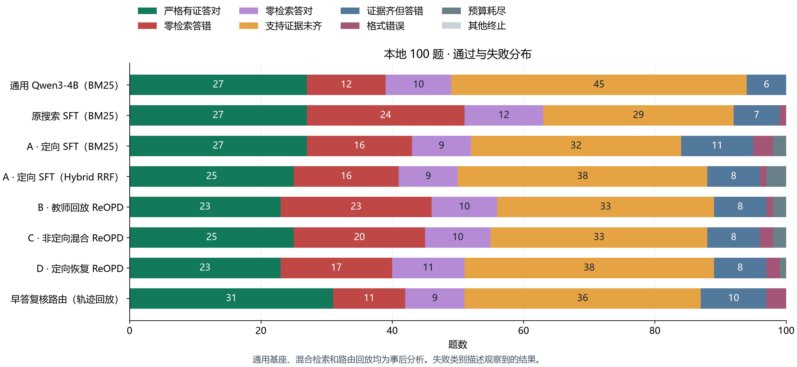
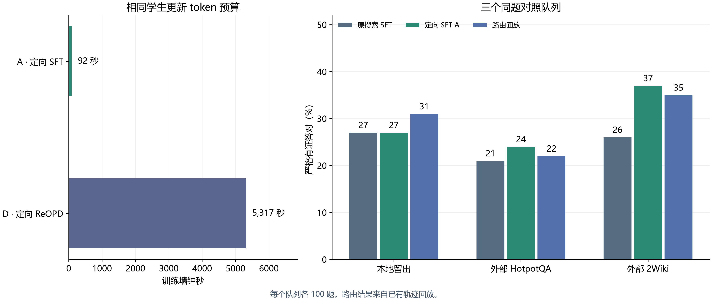

# Wiki 多跳检索课程实验

正式评测在本地留出集上比较原搜索 SFT 和四种后训练方案。以下两个事后对照复用这 100 题的共享索引、提示词、评分规则，以及每题最多 6 次搜索、每次返回 3 个片段的预算。第一组用通用 Qwen3-4B-Instruct-2507 运行同一套 BM25 环境，比较在当前工具协议下的表现。第二组用冻结的 A 适配器，将 BM25 换成 BM25 与 MiniLM 的 Hybrid RRF。两组均使用已有模型权重，沿用冻结评测的贪心解码、批大小 4 和每步 512 token 上限。模型选择沿用正式评测结果。 [冻结评测记录](reopd-local.md#最终结果2026-11-22)

## 展示结论

1. **答案匹配和证据支持是两个可测的结果。** 原搜索 SFT 的答案 EM 为 53/100，严格有证答对为 27/100。26 道答案匹配但未严格通过的题中，12 道没有进行检索。单凭轨迹无法判断模型如何得出这些答案。
2. **同一预算下，A 和 D 都恢复了两道预先定义的故障题。** 在完整 100 题中，A 相对原搜索 SFT 改善 7 题、回退 7 题，D 改善 5 题、回退 9 题。两组各更新 12,000 个学生 token，训练墙钟分别为 92.06 秒和 5,317.21 秒。D 比 A 低 4 个百分点，配对 95% 区间为 −12 至 +3。该实验未检测到 D 的优效。另有一批外部 2Wiki 题，A 的有证答对从 26/100 升到 37/100。 [冻结评测报告](../runs/reopd/formal-v2-expanded/final-test/report.md) · [外部 2Wiki 结果](../runs/reopd/public-eval-v1/reopd-2wiki/cohort_metrics.json)
3. **零检索复核在本地回放中增加 4 道有证答对题。** 原搜索 SFT 零检索且正常提交时，使用 A 从原题复核，共触发 36/100。严格成功从 27/100 升到 31/100，平均搜索从 1.03 增到 1.29 次，按已保存文本估计的平均生成量从 295.4 增到 402.3 token。规则形成于正式测试之后，真实部署延迟需要单独计时。 [路由回放](routed-demo.md)

## 事后对照

**通用基座与原搜索 SFT。** 通用 Qwen3-4B 的答案 EM 为 57/100，原搜索 SFT 为 53/100，两组严格有证答对均为 27/100。逐题比较有 15 道题只在通用基座上通过，另有 15 道题只在原搜索 SFT 上通过。通用基座减原搜索 SFT 的严格成功率差为 0 个百分点，配对 95% 区间为 −10 至 +11。结论适用于同一套本地工具协议和 BM25 语料库。 [通用基座汇总](../runs/reopd/course-extra/base-bm25/metrics.json)

**A 的混合检索。** BM25 和 Hybrid RRF 的答案 EM 均为 50/100。换用 Hybrid RRF 后，严格有证答对由 27/100 降至 25/100，改善 5 题、回退 7 题。严格成功率差为 −2 个百分点，配对 95% 区间为 −9 至 +5。平均支持句召回由 55.0% 变为 51.6%。这批题上未观察到混合检索收益。排名改变了模型看到的片段，也可能改变后续查询和停止决策。 [混合组汇总](../runs/reopd/course-extra/a-hybrid/metrics.json) · [配对指标](../runs/reopd/course-extra/paired_metrics.json)

## 课堂回放

先展示 8 组总表与失败分布，再打开以下同题轨迹。60 秒视频展示新页面的实拍画面和字幕。 [课堂回放视频](../runs/reopd/course-extra/wiki-demo-classroom.webm)

- **《Honour Killing》配乐作者的出生年**（`5a7dbe325542995ed0d1666d`）。原搜索 SFT 零检索提交 1942。A 先查出配乐作者 Uttam Singh，再查出生年 1948，最终答对并看到完整支持句。
- **Ronda Rousey 案例**（`5a73c3b555429905862fe0b6`）。原搜索 SFT 经两次搜索正确提交 Ronda Rousey。两组首条查询相同，A 第一次搜索后就提交 Jeremy Jackson，支持证据未齐。零检索复核规则在这道题上保留原搜索 SFT 的轨迹。

两图可用 `python -m scripts.plot_course_figures` 从保存的日志生成。 [失败分布 SVG](figures/failure-attribution.svg) · [成本与外评 SVG](figures/cost-and-transfer.svg)

各行均为相同 100 题。失败类别按实际终止状态和已看到的证据归类，证据齐但答错仍需逐题核查原因。
正常提交可发生在第 6 次搜索之后。零检索答对只表示轨迹里没有搜索证据。

## 逐题结果与失败分布

| 配置 | 严格有证答对 | 零检索答错 | 零检索答对 | 支持证据未齐 | 证据齐但答错 | 格式错误 | 预算耗尽 | 其他终止 |
| --- | ---: | ---: | ---: | ---: | ---: | ---: | ---: | ---: |
| 通用 Qwen3-4B（BM25） | 27/100 | 12/100 | 10/100 | 45/100 | 6/100 | 0/100 | 0/100 | 0/100 |
| 原搜索 SFT（BM25） | 27/100 | 24/100 | 12/100 | 29/100 | 7/100 | 1/100 | 0/100 | 0/100 |
| A · 定向 SFT（BM25） | 27/100 | 16/100 | 9/100 | 32/100 | 11/100 | 3/100 | 2/100 | 0/100 |
| A · 定向 SFT（Hybrid RRF） | 25/100 | 16/100 | 9/100 | 38/100 | 8/100 | 1/100 | 3/100 | 0/100 |
| B · 教师回放 ReOPD | 23/100 | 23/100 | 10/100 | 33/100 | 8/100 | 1/100 | 2/100 | 0/100 |
| C · 非定向混合 ReOPD | 25/100 | 20/100 | 10/100 | 33/100 | 8/100 | 2/100 | 2/100 | 0/100 |
| D · 定向恢复 ReOPD | 23/100 | 17/100 | 11/100 | 38/100 | 8/100 | 2/100 | 1/100 | 0/100 |
| 早答复核路由（轨迹回放） | 31/100 | 11/100 | 9/100 | 36/100 | 10/100 | 3/100 | 0/100 | 0/100 |

## 准确率与开销

| 配置 | 答案 EM | 严格有证答对 | 搜索次数/题 | 估计输出 token/题 | 训练墙钟秒 |
| --- | ---: | ---: | ---: | ---: | ---: |
| 通用 Qwen3-4B（BM25） | 57/100 | 27/100 | 1.05 | 277.4 | — |
| 原搜索 SFT（BM25） | 53/100 | 27/100 | 1.03 | 295.4 | — |
| A · 定向 SFT（BM25） | 50/100 | 27/100 | 1.22 | 321.1 | 92.06 |
| A · 定向 SFT（Hybrid RRF） | 50/100 | 25/100 | 1.23 | 328.1 | 复用 A（92.06） |
| B · 教师回放 ReOPD | 51/100 | 23/100 | 1.01 | 296.1 | 4943.63 |
| C · 非定向混合 ReOPD | 52/100 | 25/100 | 1.04 | 295.9 | 5287.00 |
| D · 定向恢复 ReOPD | 52/100 | 23/100 | 1.08 | 316.7 | 5317.21 |
| 早答复核路由（轨迹回放） | 55/100 | 31/100 | 1.29 | 402.3 | 复用 A（92.06） |

早答复核触发 36/100 题，开销包含原 SFT 首轮和触发后的 A 复核。
输出 token 由日志中的解码文本重新分词估算。原日志缺少生成 token ID、延迟与输入 token。
新增对照和路由均在正式评测冻结后分析，模型选择沿用冻结结果。
