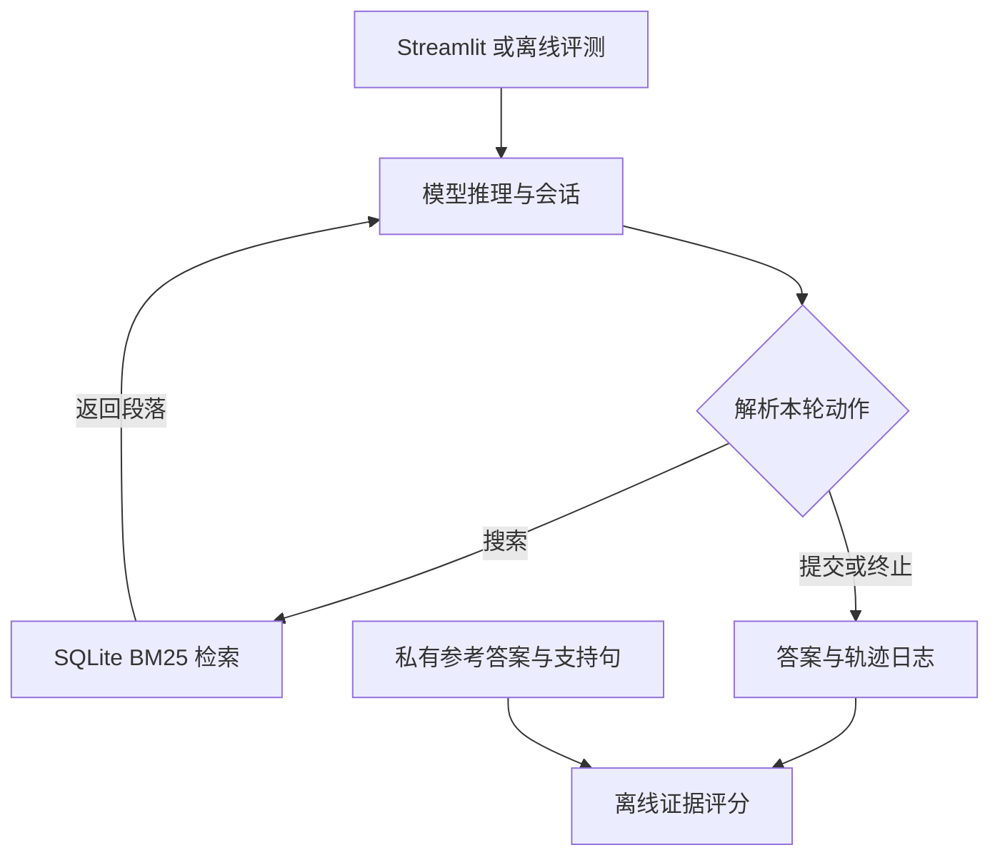

# 后训练项目介绍：Wiki 多跳搜索 Agent

更新日期：2026 年 11 月 24 日  
范围涵盖 Wiki 搜索、后训练与评测。

## 1. 项目简介

这是一个在单机上运行的小模型工具调用与后训练项目。当前主线使用 4B 参数的 Qwen3 搜索模型回答英文 Wikipedia 多跳问题。用户提交问题后，模型自行决定是否搜索、搜索什么、看到结果后是否改写查询，以及何时提交短答案。系统保存每轮查询、实际返回的文章段落、终止原因和答案。离线评测会检查模型是否答对，以及在提交前是否看到支撑答案的全部标注证据。

例如，问「电影《Honour Killing》的配乐作者出生于哪一年」，第一次搜索可定位配乐作者 Uttam Singh，第二次搜索其出生年份，最终回答 1948。这个过程需要模型把上一轮查到的人名转化成下一轮查询，并判断何时证据足够。部分题的一次搜索能返回两份证据，因此实际调用次数由检索结果和模型决策共同决定。

## 2. 项目目标与预期结果

| 目标 | 预期结果与验收方式 | 当前状态 |
| --- | --- | --- |
| 构建可信的多轮搜索环境 | 模型在固定语料和预算内真正执行搜索。可按日志复放查询、实际观察和评分 | 已完成索引、工具会话、模型轨迹和本地 Demo |
| 提高检索决策质量 | 需要查证时主动查，查到桥接实体后能补齐证据，证据足够时结束。以严格证据支持成功率为主，同时观察答案 EM、调用数和回退 | 已观察到一部分题被修复，也出现原先答对的题回退 |
| 检验定向 ReOPD 的增益 | 在相同学生更新 token 预算下，比较定向 SFT、教师前缀回放、非定向和定向 ReOPD。期望固定故障恢复提高，整体通过率保持稳定，并核算教师打分成本 | 本地四组双种子开发评测与单主种子留出评测已完成，定向 ReOPD 未达到优效标准 |
| 评估抽样以外的表现 | 在外部题目上复用冻结的适配器，检查结果能否跨题目来源复现 | 两批各 100 题已跑完，第二批 HotpotQA 的三组配对仍未完成 |
| 提供可交互的结果展示 | 可以自由提问、查看轨迹、比较模型，并演示复核时额外调用的代价 | Streamlit 页面已实现。早答复核已通过既有轨迹回放，独立留出验证待完成 |

## 3. 实现方法与技术架构



| 层 | 实现 | 主要入口 |
| --- | --- | --- |
| 数据准备 | 读取固定版本 Parquet，过滤问题、分层采样，建立段落到检索块和支持句的映射 | [download.py](../hotpot_search/download.py)、[prepare.py](../hotpot_search/prepare.py) |
| 检索 | SQLite FTS5 BM25，标题和正文权重分别为 3 和 1。另有 384 维 MiniLM 向量检索和 Qdrant local 落盘，以及等权 RRF 混合检索 | [search.py](../hotpot_search/search.py)、[hotpot-search.md](hotpot-search.md) |
| 工具与会话 | FastAPI 可提供 8020 检索 API 与 8021 训练交互 API。正式实验直接读取同一只读 SQLite 索引，进程内维护会话、预算、已见证据与终止状态 | [api.py](../hotpot_search/api.py)、[training_api.py](../hotpot_search/training_api.py)、[reopd.py](../hotpot_search/reopd.py) |
| 模型与后训练 | PyTorch、Transformers、PEFT。学生用 CUDA 运行，ReOPD 训练时教师冻结并在 CPU 打分，适配 16 GiB 显存的单机 | [reopd_model.py](../hotpot_search/reopd_model.py)、[reopd_train.py](../hotpot_search/reopd_train.py) |
| 评测与展示 | 独立评测读取参考答案和证据，按题对齐多个模型并保存原始轨迹。Streamlit 8502 展示实时查询、归档案例与复核路由 | [reopd_final.py](../hotpot_search/reopd_final.py)、[demo_ui.py](../hotpot_search/demo_ui.py)、[demo_run.py](../hotpot_search/demo_run.py) |

正式模型交互沿用 Search-R1 风格。模型每轮可输出一条 JSON 搜索动作，也可用 `Answer: \boxed{...}` 提交答案。每次真实搜索最多返回 3 个块，每题最多搜索 6 次。运行器把返回的段落追加到历史并交给模型下一轮。正式训练和评测沿用固定协议、语料与索引版本，标准答案和支持事实只供评分器和事后审核使用。训练交互接口还支持读取已搜索到的文档，正式 ReOPD 实验的模型动作使用搜索与提交。

### 模型从哪里来

| 角色 | 权重 | 用途 |
| --- | --- | --- |
| 通用基座 | `Qwen/Qwen3-4B-Instruct-2507` | 在 300 道轨迹题上做初始比较 |
| 搜索 SFT 学生 | `baohao/Search_Qwen3-4B-Instruct-2507_SFT` | 四组微调的共同起点，也是最终表里的「原搜索 SFT」 |
| 搜索 SFT-RL 教师 | `baohao/Search_Qwen3-4B-Instruct-2507_SFT-RL` | 续跑失败轨迹、提供成功动作，以及对同一学生 action token 打分 |

本项目直接使用上游发布的搜索 SFT 和 GRPO 教师权重。本地实现了语料、交互、失败状态筛选、LoRA 和评测，研究的是在公开搜索学生上再做一轮适配。三个 checkpoint 的固定版本及环境复现命令见 [本地 ReOPD 实验记录](reopd-local.md)。

## 4. 训练、开发与测试数据

### 4.1 本地 HotpotQA 划分

源数据为 HotpotQA 官方 `distractor/train` 的 90,447 道英文问题。过滤支持句缺失或越界的 22 题后，以种子 20261116 按 bridge/comparison 和原始难度分层抽取 800 题。选择 HotpotQA 是因为它同时提供短答案、候选段落和支持句，可分别检查「答案对了」和「证据查到了」，也包含桥接、比较及有干扰材料的情形。

| 划分 | 数量 | 用法 |
| --- | ---: | --- |
| `sft_seed` | 300 | 预留用于采集 Wiki SFT 示例。当前四组实验的定向样本来自下方轨迹池 |
| `rl` | 300 | 生成模型轨迹、诊断失败、挖掘和审核恢复样本，作为四组训练池的题目来源 |
| 本地 `dev` | 100 | 看协议、检索诊断与开发集对照，比较训练种子 42 和 43 |
| 本地 `test` | 100 | 冻结后进行正式评测。主种子固定为 42，按相同题目比较四组与原搜索 SFT |

四份题集约 80% 为 bridge、20% 为 comparison，难度近似均衡。跨划分规范化题干去重、核心支持标题零重叠。所抽题目的所有候选段落和额外背景材料一起构成共享语料，包含 17,585 个段落、20,000 个检索块，保留 1,895 条标注支持事实。测试相关原文可以在共享语料中检索，这是开卷设定；模型每道题使用同一个索引，参考答案和支持句标注单独保存。其他提及实体仍可能重叠，公开权重的历史数据重叠也未排除。本项目的本地 dev/test 均从官方 train 中留出。数据来源、划分与文件校验值见 [数据清单](../data/hotpotqa/v1/manifest.json)。

### 4.2 外部泛化数据

| 批次 | 来源与筛选 | 状态 |
| --- | --- | --- |
| HotpotQA 第一批，100 题 | 官方 `distractor/dev`，按题型比例抽样，排除与本地划分规范化题干相同的题 | SFT、A、D 均已完成 |
| 2WikiMultiHopQA，100 题 | `baohao/search-test` 中可唯一匹配 2Wiki dev 镜像题干、答案和可追溯支持句的样本 | SFT、A、D 均已完成 |
| HotpotQA 第二批，100 题 | 与第一批采用相同抽样规则，两批题目互不重复 | 仅有原 SFT 的部分批次缓存 |

同源问题共用一套候选段落构建的 BM25 库，两个 HotpotQA 批次共享索引。外评沿用冻结的种子 42 权重，保持统一的提示、搜索预算和生成上限。成绩适用于这些抽样队列和受限语料，官方 fullwiki 和完整 ReOPD 测试集有不同的评测口径。输入版本与采样清单见 [外部评测清单](../runs/reopd/public-eval-v1/benchmark/manifest.json)。

## 5. 后训练是怎么做的

### 5.1 找出学生犯错且教师能救回的状态

1. 用通用基座、搜索 SFT 学生和 SFT-RL 教师在同一批 `rl` 题上跑真实检索。对学生的失败记录当前问题、已执行的查询和已经返回的观察。这里的「前缀」是模型生成下一步动作之前看到的输入与历史。
2. 首先尝试「搜索一次后在证据不足时提交」。300 题中有 69 个候选，固定前缀后分别让教师续跑三次。自动检查通过 5 题，人工审核批准 3 题，低于预设的 20 题门槛，因此这一类未开训。
3. 改用「从未搜索就答错」。该类前缀只含问题和协议，没有已返回的搜索结果。84 个候选共完成 252 次教师续跑，28 题自动通过，人工排除 7 个别名、歧义或证据不足的案例，最终 21 题进入定向池。通过要求三次均可评分，至少两次教师先搜索并最终答对、看到完整支持证据。
4. 两个种子分别构建训练顺序和对照池。以种子 42 为例，A 与 D 共用 21 条定向前缀与 63 条普通前缀，C 把 21 条定向前缀换成轮次和提示长度匹配的普通前缀。B 按轮次衰减采样普通教师成功轨迹前缀。

### 5.2 四组对照如何更新模型

| 组别 | 训练输入 | 学习信号 | 想回答的问题 |
| --- | --- | --- | --- |
| A · 定向 SFT | 定向恢复与普通前缀，比例 1:3 | 教师成功续跑的下一动作，做交叉熵监督 | 直接模仿教师成功动作能修复多少？ |
| B · 教师前缀回放 ReOPD | 成功的教师轨迹前缀，第 `t` 轮以 `0.6^t` 概率保留 | 让当前学生自己采样下一动作，教师对该动作 token 打分 | 普通的教师前缀回放能带来多少收益？ |
| C · 非定向 ReOPD | 普通前缀，控制轮次和上下文长度 | 同 B | 在长度、轮次和预算相近时，普通前缀表现如何？ |
| D · 定向恢复 ReOPD | 与 A 相同的前缀和顺序 | 同 B | 故障前缀本身是否有效？同一批前缀改用蒸馏能否优于模仿？ |

四组都从同一个搜索 SFT 学生出发，使用 rank 8、alpha 16 的 LoRA 更新注意力层 `q_proj` 和 `v_proj`，AdamW 学习率为 2e-5。每组每个种子更新恰好 12,000 个学生目标 token，共保存和重载验证了 8 份适配器。提示、历史、工具观察作为上下文，其 token 不计入目标 loss。

ReOPD 每次在一个选定或复放的历史上采样学生下一条动作。冻结教师在相同提示、相同学生动作 token 上计算对数概率。训练使用采样 reverse KL 的策略梯度估计，对学生倾向生成、教师相对给低概率的 token 施加纠正信号。训练阶段直接对新采样动作打分；只在构造历史前缀时复放相关检索。新动作能否查到正确文章、后续能否答对，由完整轨迹评测检验。这个实现将训练限制在单步动作反馈，控制了本地资源需求。

## 6. 目前实测效果

**主指标为严格证据支持成功。** 一道题须按协议提交、归一化短答案匹配，并且模型提交前已看到全部标注支持文档和支持句。答案 EM 只看短答案匹配。证据可见性可以核对搜索是否把材料送进上下文，模型具体如何利用证据仍需看轨迹。

### 6.1 初始诊断和开发集

| 300 道 `rl` 题 | 答案 EM | 严格证据支持 | 总搜索次数 |
| --- | ---: | ---: | ---: |
| 通用 Qwen3-4B 基座 | 163/300 | 88/300 | 305 |
| 原搜索 SFT 学生 | 138/300 | 54/300 | 275 |
| 搜索 SFT-RL 教师 | 187/300 | 129/300 | 517 |

这批题用于筛训练池。教师比学生找齐证据并答对的题更多，同时调用搜索约 1.9 倍。原搜索 SFT 在这套本地索引上的成绩低于通用基座，说明上游训练后的权重在换检索环境后仍需验证，具体原因需要额外对照。

| 本地 dev 严格证据支持 | 原搜索 SFT | A | B | C | D |
| --- | ---: | ---: | ---: | ---: | ---: |
| 训练种子 42 | 20/100 | 24/100 | 23/100 | 22/100 | 22/100 |
| 训练种子 43 | 20/100 | 24/100 | 21/100 | 25/100 | 22/100 |

开发集另有 28 道固定故障题。种子 42 的 A/B/C/D 各恢复 4/4/3/4 题，种子 43 各恢复 3/4/4/3 题。[开发与基线实验记录](reopd-local.md)

### 6.2 冻结的本地测试集

| 组别 | 答案 EM | 严格证据支持 | 固定故障恢复 | 原有简单题回退 | 教师打分输入 token | 训练墙钟 |
| --- | ---: | ---: | ---: | ---: | ---: | ---: |
| 原搜索 SFT | 53/100 | 27/100 | 0/24 | 0/15 | — | — |
| A · 定向 SFT | 50/100 | 27/100 | 2/24 | 3/15 | 0 | 92 秒 |
| B · 教师前缀回放 ReOPD | 51/100 | 23/100 | 1/24 | 5/15 | 53,547 | 4,944 秒 |
| C · 非定向 ReOPD | 52/100 | 25/100 | 1/24 | 4/15 | 57,810 | 5,287 秒 |
| D · 定向恢复 ReOPD | 52/100 | 23/100 | 2/24 | 3/15 | 57,252 | 5,317 秒 |

固定故障自动从原搜索 SFT 的同一批留出轨迹定义，24 题都是「未经检索直接答错」，并且均可评分。A 和 D 各恢复 2 题，D 的整体严格成功率比 A 低 4 个百分点，配对 95% 区间为 −12 至 +3 个百分点。固定恢复的 D−A 差值区间为 −16.7 至 +16.7 个百分点。D 比 B、C 各多恢复一题，两项配对区间的下界均为 0，未达到预设的优效门槛。D 的训练墙钟约为 A 的 58 倍。就这批结果而言，额外计算开销没有对应到可确认的恢复收益。[最终评测报告](../runs/reopd/formal-v2-expanded/final-test/report.md)

### 6.3 已完成的外部对照

| 数据集，每批 100 题 | 原搜索 SFT · EM / 严格 | A · EM / 严格 | D · EM / 严格 |
| --- | ---: | ---: | ---: |
| HotpotQA 第一批 | 33 / 21 | 36 / 24 | 36 / 23 |
| 2WikiMultiHopQA | 40 / 26 | 49 / 37 | 38 / 23 |

A 在已完成的两批外评中都获得更多严格成功题，2Wiki 中增加 11 题。D 在两批分别增加 2 题和减少 3 题。第二批 HotpotQA 截至核查时仍缺完整配对结果。[HotpotQA 结果](../runs/reopd/public-eval-v1/hotpot-first/cohort_metrics.json) · [2Wiki 结果](../runs/reopd/public-eval-v1/reopd-2wiki/cohort_metrics.json)

### 6.4 早答复核路由

页面有一种推理策略：先跑原搜索 SFT。如果它正常提交且搜索次数为零，就从原问题重跑 A 并返回 A 的结果。其余情形直接使用原模型结果。触发条件只依赖模型的终止状态和搜索次数，所有对照均回放已经保存的同题完整轨迹。

| 队列 | 原搜索 SFT | 始终用 A | 路由 | 触发复核 |
| --- | ---: | ---: | ---: | ---: |
| 本地 dev | 20/100 | 24/100 | 24/100 | 37/100 |
| 本地 test | 27/100 | 27/100 | 31/100 | 36/100 |
| 外部 HotpotQA 第一批 | 21/100 | 24/100 | 22/100 | 31/100 |
| 外部 2Wiki | 26/100 | 37/100 | 35/100 | 40/100 |

路由改变的是系统选择哪条推理路径。本地 test 在制定路由规则前已用于正式评测，两个外部批次也来自已有轨迹。表中增量属于事后回放，独立题集上的稳定性仍待验证。复核触发时要串行运行两次 4B 推理，页面可能重新加载模型。自由提问可以看证据和过程，无参考标签可做即时离线评分。[路由实现与回放](routed-demo.md) · [配对数据](../runs/reopd/routed-eval/report.json)

## 7. 为什么 Wiki 效果仍有限

| 原因 | 现有证据与解释 |
| --- | --- |
| 准确回答与找到证据是两项能力 | 原搜索 SFT 在本地测试 EM 53/100、严格成功 27/100。26 道答案匹配题未同时满足完整证据和正常提交条件。排查时应逐题看证据是否进入观察、是否格式终止、是否过早停止 |
| 首跳检索与排序会限制后续决策 | 本地 dev 用原题只查一次，BM25 支持文档 Recall@10 为 87.5%，全部支持文档同时找到的题占 75%。正式 Agent 每次只看 Top 3，实际必须靠查询改写和多轮搜索补齐证据。该 Top 10 诊断无法直接估计正式 Top 3 的召回率。[检索审计](hotpot-search.md) |
| 教师整体更强，可恢复案例仍少 | 首选故障仅 3 个审核通过案例。正式故障也仅 21 个不同定向训练题，每个适配器 12,000 目标 token 包含重复训练及普通状态。样本的覆盖范围是已知限制，扩大样本能否改善仍需消融验证 |
| 实际训练集中于首个决策 | 最终定向样本处于零检索状态，训练更直接干预「先搜还是直接答」。第一轮检索后辨别同名实体、改写 query、比较两份证据和决定何时停，涉及不同状态。单步教师 token 信号也无法直接检验这个 query 的实际检索结果。这些是合理的解释，现有实验没有分别测出各因素的影响 |
| 修复一些题与损害旧能力同时发生 | A 在本地最终测试相对原 SFT 改善 7 题、回退 7 题，总量持平。D 改善 5 题、回退 9 题。固定故障恢复数只能说明目标子集的几个个案，整套测试还包含原先能解决的行为。[逐题变化](../runs/reopd/formal-v2-expanded/final-test/changed_cases.jsonl) |
| 当前证据不足以归因到单一超参或判断等效 | 正式留出有 100 题，目标故障只有 24 题。教师 CPU 打分提高墙钟成本，区间宽反映目前难以分清方法差异和样本波动。训练池规模、检索环境、单步目标和 LoRA 配置的独立贡献仍缺少消融 |

两个真实测试案例可以说明改进与回退为何会同时出现：

- `5a7dbe325542995ed0d1666d`。原搜索 SFT 零检索回答 1942。A 先查电影配乐再查 Uttam Singh 的出生年份，回答 1948，支持句覆盖从 0 变为完整。
- `5a73c3b555429905862fe0b6`。两组第一条查询相同。原搜索 SFT 继续核查 Ronda Rousey 与节目的关联后答对；A 第一轮就提交 Jeremy Jackson，支持句只覆盖一半。这类回退需要通过检索后的终止状态诊断才能识别。

可直接承接的验证有三项：完成剩余的外部 HotpotQA 配对；预先冻结早答复核规则并在新题上记录准确率、回退、调用和真实延迟；按「查询没召回」「召回后误读」「证据不足时提交」「输出协议失败」抽样标注，再用相同题目比较自然检索、支持标题检索与直接提供支持句。后两种诊断可帮助定位检索与证据使用各自的瓶颈。

## 8. 运行与复核入口

在项目根目录运行。实时模型页面依赖已准备的语料索引、模型权重和模型环境。

```powershell
# Wiki 展示页
.\.model-venv\Scripts\python.exe -m streamlit run hotpot_search/demo_ui.py --server.address 127.0.0.1 --server.port 8502

# Wiki 检索 API 与训练交互 API
.\Start-HotpotSearch.ps1
.\Start-HotpotSearch.ps1 -Training

# 用已保存的轨迹重算早答复核结果
.\.model-venv\Scripts\python.exe -m hotpot_search.routed_eval
```

展示地址为 [Wiki 多跳搜索](http://127.0.0.1:8502)，两个 API 的文档地址分别为 [检索 API](http://127.0.0.1:8020/docs) 和 [训练交互 API](http://127.0.0.1:8021/docs)。依赖安装、首次建库和正式实验命令见 [仓库 README](../README.md) 和 [ReOPD 实验记录](reopd-local.md)。`runs/` 和大体积索引、权重通常保存在实跑机器，文中运行产物链接依赖相应本地文件。
