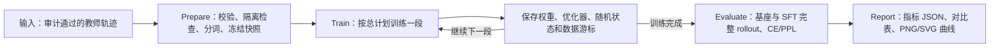

# 可复用训练流水线

统一入口为项目根目录的 `Run-Training.ps1`，配置示例为 `configs/teacher-sft.example.json`。当前实现 **Qwen3-1.7B 的 BF16 LoRA SFT**，复用已经验证过的数据、训练、评测和图表模块。PPO／GRPO／DPO、全参数训练和量化训练尚未接入，不提供无效的方法选项。



## 快速使用

在 `D:\work\PostTraining` 执行。先复制示例配置并修改 `run_dir`，每个新实验使用新的目录；输入路径相对于项目根目录解析。下面的命令是不同操作，不要把 `All` 与 `Train` 同时启动。

```powershell
# 只查看计划，不训练，不调用 API
.\Run-Training.ps1 -Action Plan -Config configs/teacher-sft.example.json

# 数据预处理：生成独立快照与统计
.\Run-Training.ps1 -Action Prepare -Config configs/teacher-sft.example.json

# 开始一段：默认最多训练 100 次优化器更新后保存、退出
.\Run-Training.ps1 -Action Train -Config configs/teacher-sft.example.json

# 恢复下一段，也可覆盖本次的段长
.\Run-Training.ps1 -Action Resume -Config configs/teacher-sft.example.json -SegmentUpdates 100

# 在另一个终端查看进度，或请求安全暂停
.\Run-Training.ps1 -Action Status -Config configs/teacher-sft.example.json
.\Run-Training.ps1 -Action Pause -Config configs/teacher-sft.example.json
```

无人值守执行完整流程：

```powershell
.\Run-Training.ps1 -Action All -Config configs/teacher-sft.example.json
```

`All` 会自动接续由段长触发的暂停，直到总训练计划完成，再运行基座／SFT 评测、测试参考动作似然和图表报告。**人工 Pause 会让 All 停下来**，再次主动运行 Resume 或 All 后继续。Pause 在训练模块处于 preparing／training 时有效，响应发生在当前完整优化器更新结束后。

训练完成后，也可单独执行 `Evaluate` 和 `Report`。已完成的模型训练与评测会校验后跳过，Report 可以重新生成表格和图表。状态与日志在配置的 `run_dir` 中，`complete` 表示完整流程／报告完成；`training_complete` 表示仅训练完成。

## 数据输入与处理

`data.release` 指向 `audit_teacher_sft` 产出的发布目录，包含 `manifest.json`、`train-actions.jsonl` 和轨迹文件。每条动作需要：

```json
{
  "case_id": "train-task-id",
  "split": "train",
  "gold_visible": false,
  "group": "direct",
  "turn": 1,
  "prompt": [
    {"role": "system", "content": "工具协议"},
    {"role": "user", "content": "题目的 JSON 内容"}
  ],
  "completion": [{"role": "assistant", "content": "一个动作 JSON"}]
}
```

Prepare 检查文件哈希、动作及完整上下文结构、重复样本、训练／验证／测试公司与报告隔离、盲生成标记，以及上下文长度。损失只覆盖当前 completion 和 EOS。超长样本会报错，不静默截断；重复或泄漏样本会报错，不悄悄删掉以致破坏多轮轨迹。

输入是采集程序的原始结果时，先用 `finance_agent.audit_teacher_sft --run <采集目录> --data <财报数据集> --output <发布目录>` 独立重放，之后将发布目录写入配置。公开问答数据不能直接冒充该工具轨迹格式，需要先转换并验证。

预处理会复制发布文件到 `run_dir/prepared/release/`，保留原始文件不变；统计动作数、题型分布、序列长度、输入与监督 token 数。冻结后的数据被修改时拒绝继续。

## 训练配置与分段语义

| 配置项 | 含义 |
| --- | --- |
| `method.name` | 当前为 `lora_sft` |
| `method.rank / alpha / dropout / target_modules` | LoRA 参数及目标投影层 |
| `training.max_updates` | 总优化器更新数；null 表示完整遍历当前数据一轮 |
| `training.accumulation` | 单样本微批的梯度累积数 |
| `training.max_length` | 上下文长度上限，不截断 |
| `training.learning_rate` | AdamW 固定学习率 |
| `training.seed / selection` | 固定抽样顺序；random 或覆盖长样本的 mixed |
| `training.checkpoint_every` | 每多少次完整更新保存断点 |
| `training.segment_updates` | 每次启动最多执行多少次更新；null 表示一次跑完 |
| `training.speed_warmup_updates` | 仅在速度统计中排除预热步，不是学习率 warmup |
| `evaluation.split` | 默认 validation；最终评测时可改用 test 并新建实验配置 |

本批 3,156 条动作、梯度累积 4，一整轮是 **789 次更新**。段长 100 表示 0→100→200→…→789，最后一段 89 步；不是每次重新跑一轮。当前训练后端最多遍历数据一轮，不能通过修改已完成实验的总步数来续出第二轮。

其余固定训练实现：微批 1、BF16、SDPA、非重入梯度检查点、梯度范数裁剪 1、AdamW、completion/EOS loss。训练日志按动作等权平均，参考动作 CE/PPL 则按目标 token 等权统计。

## 断点包含什么

- LoRA 权重、AdamW 动量和步数。
- CPU／CUDA／Python 随机状态。
- 已完成更新、固定数据顺序、分词结果、参数顺序和文件哈希。
- 训练配置、依赖版本、源代码快照及逐步记录。

断点先写临时目录，再提交目录和最新指针；不会从未写完的目录恢复。安全暂停只在优化器更新边界保存，然后进程退出释放其 GPU 资源。意外强制结束只能保证恢复到最近已提交断点，其后的未提交更新会重跑；恢复会归档旧日志尾部，最终报告中的更新序列不重复。

段长和保存频率可以改变；数据、学习率、LoRA 参数、批次和抽样顺序等影响梯度的配置改变时必须新建实验。运行锁用于防止重复启动。若操作系统强制终止后留下锁，须确认对应进程已经退出再处理锁文件；脚本不会自动杀掉别的进程或绕过锁。

## 评测和结果呈现

默认使用 80 题验证集，训练过程不读取验证／测试标准答案。独立自主 rollout 用于任务成功率、EM、最终状态 Accuracy、Macro Precision／Recall／F1、数值／单位、引用、工具动作、预算和停止行为。CE/PPL 与 Token Accuracy 另用标准轨迹做 teacher forcing，不等于自由生成正确率。

所有题数、更新数、参考动作数由实际文件计算，报告和绘图不再固定为本次的 120／789／400。报告包含前后对比、分题型指标、失败记录、JSON 原始数据、原始训练 loss／20 步平滑曲线、累计评测成功率、累计 CE/PPL 和 PNG／可编辑 SVG。

累计评测曲线横轴是评测样本数；只有训练 loss 曲线横轴是训练步数。目前未逐 checkpoint 跑质量评测，不虚构中间验证曲线。根据最终测试错误改训练后，需要另留新的最终测试集。

目录结构：

```text
run_dir/
  experiment.json       # 初始完整配置；每次有效配置另记 events.jsonl
  source-index.json     # 当前代码哈希，所有版本快照保留在 sources/
  state.json            # 当前阶段及状态
  events.jsonl          # 子进程、命令、阶段、运行控制参数
  logs/                 # 各阶段 stdout/stderr
  prepared/             # 冻结输入和数据统计
  training/             # adapter、checkpoints、sampling、steps、report
  evaluation/base/      # 基座完整轨迹，可按题恢复
  evaluation/sft/       # SFT 完整轨迹，可按题恢复
  evaluation/likelihood/# 每 20 条参考动作保存，可恢复 CE/PPL
  report/               # 对比表、metrics.json、figures/*.png/*.svg
  artifacts.json        # 输入报告和输出结果的哈希及位置
```

模型阶段使用 `.model-venv`，汇总和绘图使用 `.venv`，可通过 `runtime` 改解释器路径。当前模型环境为 torch 2.11.0+cu128、transformers 4.57.6、peft 0.18.1；绘图可用 `uv pip install --python .venv/Scripts/python.exe -r requirements-evaluation.txt` 安装。

## 本次实验复用与实际验证

复用已经完成的 789 步训练与 120 题测试结果，只重新生成报告：

```powershell
.\Run-Training.ps1 -Action Report -Config configs/teacher-sft.completed-20261113.json
```

该配置中的历史 artifacts 只读，拒绝执行训练或评测，不会改写原权重。新报告在 `data/experiments/teacher-sft-replay-20261116/report/README.md`。

`configs/teacher-sft.smoke.json` 已实际完成两段 GPU 短训：第 2 步保存退出，恢复到第 4 步，最终适配器重载校验误差为 0。该短训目录只用于验证流程，不代表新模型质量；完整训练成绩仍使用原 789 步适配器。
